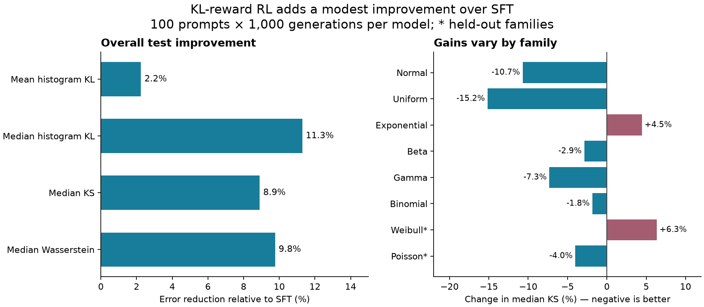
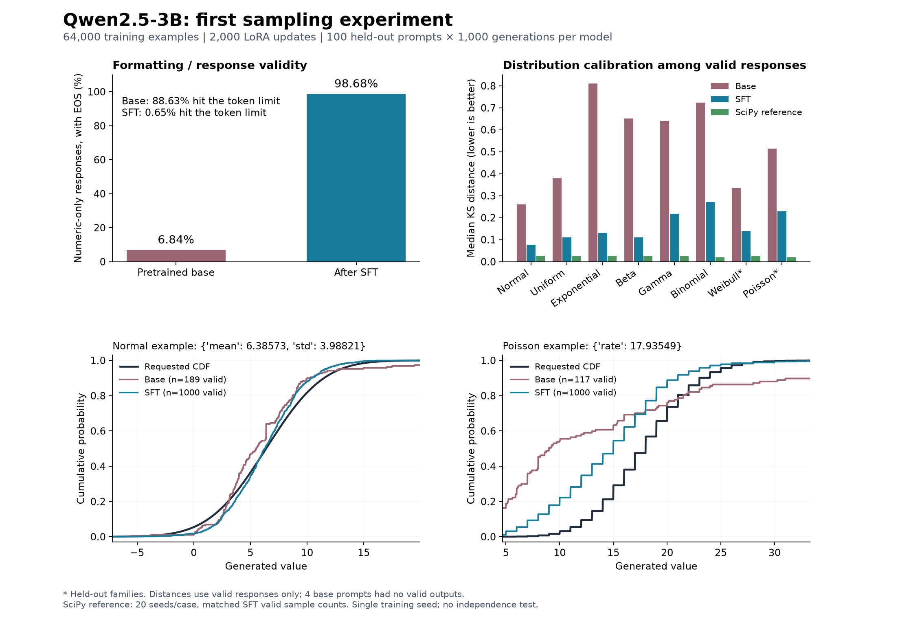

# llm-random-number-generator

Investigating whether language models can generate numbers according to requested probability distributions.

This repository publishes the completed **Qwen2.5-3B SFT baseline and batch-KL-reward RL pilot**. SFT used cross-entropy on independently sampled target answers; RL continued from that adapter using rewards from the model's own generated batches. The optional direct soft-target KL trainer is implemented but has not been run.

## Completed KL-reward RL results

The final 250-update RL adapter and its starting SFT adapter were evaluated on the same **100 held-out prompts × 1,000 generations per prompt**, using identical decoding settings. Lower distribution distances are better.



| Metric | SFT | SFT + KL-reward RL | Relative reduction |
|---|---:|---:|---:|
| Mean histogram KL | 0.2277 | 0.2226 | 2.2% |
| Median histogram KL | 0.1191 | 0.1057 | 11.3% |
| Median KS distance | 0.1392 | 0.1268 | 8.9% |
| Median normalized Wasserstein distance | 0.1122 | 0.1013 | 9.8% |
| Numeric-only responses with EOS | 98.68% | 98.59% | — |

This is a modest incremental improvement: KL improved on 61 of 100 prompts. Normal and uniform improved on median KS; exponential and Weibull regressed. The unseen-family aggregate worsened slightly on median KS and Wasserstein. One training seed and no equal-compute SFT continuation control limit conclusions.

The algorithm is on-policy **REINFORCE with a leave-one-out batch reward baseline**, not PPO or GRPO. It optimizes negative smoothed forward histogram KL with a separate reference-policy KL penalty. The run used 128,000 sampled training responses and took **22m34s** on one H200; evaluation took **5m43s**. Test histogram KL is computed post hoc from 1,000 draws, whereas training/validation groups contain 256; their absolute KL values are not directly comparable.

- [Full RL report](results/rl-v1/analysis/RESULTS.md)
- [Implementation, hyperparameters, and reproduction](docs/kl-rl-experiment.md)
- [Recorded results, all SFT/RL test generations, and training history](results/rl-v1/)
- [W&B comparison dashboard](https://forge.coreweave.com/wandb/yash2007-university-of-washington/stochastic-llm/runs/lyb3xv9l)
- [W&B RL training](https://forge.coreweave.com/wandb/yash2007-university-of-washington/stochastic-llm/runs/tx91cho0)
- [W&B final evaluation](https://forge.coreweave.com/wandb/yash2007-university-of-washington/stochastic-llm/runs/n9d9aegn)

## SFT results

Both checkpoints were evaluated on the same **100 held-out prompts × 1,000 independent generations**, for 200,000 model responses in total.



| Metric | Pretrained base | After SFT |
|---|---:|---:|
| Numeric-only responses, terminated with EOS | 6.84% | **98.68%** |
| Median normalized Wasserstein distance ↓ | 1.6858 | **0.1122** |
| Median KS distance ↓ | 0.5428 | **0.1392** |
| Out-of-support values among numeric responses | 19.87% | **1.35%** |

Lower distribution distances are better. Wasserstein is normalized by the target's 95th–5th percentile width; KS is the largest gap between the empirical and target cumulative distributions. Medians aggregate prompts.

For normal distributions, median KS improved from **0.2613 to 0.0763**. For held-out Weibull and Poisson families combined, it improved from **0.4016 to 0.1696**.

The result is encouraging, but calibration remains imperfect: a direct SciPy reference produced median KS **0.0247** and normalized Wasserstein **0.0113**, using matched valid sample counts and 20 repetitions per case.

### How to interpret these results

- Formatting is a substantial confound: 88.6% of base responses reached the 32-token limit. A format-matched control is needed to isolate the calibration effect.
- Distribution distances use only valid numeric responses, including out-of-support values. Four base prompts had no valid answers and are excluded from its distance medians.
- Numeric validity requires one finite number and EOS; it does not guarantee the number lies within the target's support.
- One training seed was used. These tests do not establish exact sampling, independence, general language retention, or an effect specifically attributable to RLHF.

## Experiment at a glance

| Setting | Value |
|---|---|
| Base model | [`Qwen/Qwen2.5-3B`](https://huggingface.co/Qwen/Qwen2.5-3B) |
| Training data | 64,000 examples: 2,000 parameter configurations × 32 draws |
| Training families | Normal, uniform, exponential, beta, gamma, binomial |
| Held-out families | Weibull, Poisson |
| Adaptation | LoRA rank 16, alpha 32, dropout 0.05 |
| Optimizer / learning rate | AdamW / `2e-4` |
| Training budget | 2,000 updates, effective batch size 32, one epoch |
| Hardware / precision | One NVIDIA H200 / BF16 |
| Training job time | 4m50s, including a 4m14s training loop |

Evaluation used temperature 1, top-p 1, top-k disabled, and no repetition penalty. Tests cover unseen parameter ranges, held-out distribution families, and new prompt wording. Invalid responses were not repaired or resampled.

## Code and recorded artifacts

The repository includes the SFT training/evaluation pipeline, pinned configs, per-prompt results, the numerical-sampler reference, and the two plotted cases' raw generation logs.

- [Full SFT setup, reproduction commands, and limitations](docs/sft-experiment.md)
- [Recorded metrics and provenance](results/sft-v1/)
- [Per-prompt base results](results/sft-v1/base/results.csv) · [Per-prompt SFT results](results/sft-v1/sft/results.csv)
- [Download the figure as PDF](results/sft-v1/sampling-results.pdf)
- [W&B results dashboard](https://forge.coreweave.com/wandb/yash2007-university-of-washington/stochastic-llm/runs/zkuvylag)
- [W&B training run](https://forge.coreweave.com/wandb/yash2007-university-of-washington/stochastic-llm/runs/xcj01bg1)

Full raw generations and trained adapter artifacts are stored with the W&B runs. Model weights, credentials, environments, and scheduler logs are not checked into Git.

### Inspect the results locally

```bash
python3.12 -m venv .venv
source .venv/bin/activate
python -m pip install -e '.[dev,analysis]'
python -m pytest -q
python scripts/analyze_results.py
```

The analysis command regenerates the figure from the committed results without a GPU. Tests use a tiny local model and offline tracking. Training the full checkpoint requires CUDA; see the [SFT reproduction guide](docs/sft-experiment.md).
## Original technical overview and equations

The following retains the original research formulation. The completed implementation uses this batch-KL reward with a leave-one-out baseline and a separate reference-policy KL penalty; measured SFT and RL results are reported above.

---

# llm-random-number-generator
Trying to make a LLM that can potentially generate numbers pseudo-randomly from some target distribution


### Information
# Training LLMs to Sample from Probability Distributions

This project investigates whether a language model can learn to generate numbers according to a requested probability distribution.

The goal is **distributional fidelity**: repeated, independent responses should have the correct frequencies, spread, and tail behavior.

For example, given:

> Sample exactly one number from a normal distribution with mean 0 and standard deviation 1.

Repeated responses should approximately follow:

```math
X \sim \mathcal{N}(0,1).
```

Generating individual numbers that look plausible is insufficient. Correct sampling is a property of the distribution of responses across many requests.

## Research Question

Can fine-tuning with a reward based on distributional mismatch teach an LLM to become a better conditional sampler?

We investigate generalization to:

- Unseen parameters of familiar distributions.
- Distribution families absent from training.
- Different prompt wording.
- Eventually, explicitly defined distributions over nonnumeric choices.

## Problem Formulation

Let:

- $c$ denote a prompt specifying a distribution and its parameters.
- $p(x \mid c)$ denote the requested target distribution.
- $\pi_\theta(y \mid c)$ denote the probability of generating response $y$.
- $f(y)$ parse a response into a number, or return $\bot$ for an invalid response.

The model induces an output distribution:

```math
q_\theta(x \mid c)
=
\sum_{y:f(y)=x} \pi_\theta(y \mid c).
```

Our objective is to bring this induced distribution closer to the requested target.

## Batch-Level KL Reward

For each prompt, generate $N$ independent responses:

```math
Y_1,\ldots,Y_N
\overset{\mathrm{iid}}{\sim}
\pi_\theta(\cdot \mid c),
\qquad
X_i=f(Y_i).
```

Each response is generated from a fresh context containing the same prompt.

### Discretizing the Target

We compare probability masses over bins rather than directly comparing an empirical sample with a continuous density.

For numeric bins $B_1,\ldots,B_K$, define:

```math
p_j(c) = \Pr(X \in B_j \mid c).
```

For a continuous target with density $p(x \mid c)$:

```math
p_j(c) = \int_{B_j} p(x \mid c)\,dx.
```

Add an invalid-output category, indexed by $\bot$, with target probability:

```math
p_\bot(c)=0.
```

Malformed responses, unfinished responses, and values outside the distribution's support are assigned to this category.

### Estimating the Model Distribution

Let $n_j$ be the number of generated responses assigned to category $j$.

Using additive smoothing with $\alpha>0$:

```math
\widehat{q}_j
=
\frac{n_j+\alpha}{N+\alpha(K+1)}.
```

Smoothing prevents an unobserved target bin from producing an infinite KL estimate.

### Reward Function

The batch reward is the negative forward KL divergence:

```math
R(c,Y_{1:N})
=
-D_{\mathrm{KL}}\!\left(
p(\cdot \mid c)
\,\middle\|\,
\widehat{q}
\right).
```

Explicitly:

```math
D_{\mathrm{KL}}(p\|\widehat{q})
=
\sum_{j:p_j>0}
p_j \log\frac{p_j}{\widehat{q}_j}.
```

**Higher reward means closer agreement with the target distribution.**

Invalid responses remain in the sample count and normalization. Discarding them before computing the reward would hide poor response validity.

## Reinforcement Learning Objective

We maximize expected batch reward:

```math
J(\theta)
=
\mathbb{E}_{c}
\mathbb{E}_{Y_{1:N}\sim\pi_\theta}
\left[R(c,Y_{1:N})\right].
```

A policy-gradient estimator is:

```math
\nabla_\theta J
=
\mathbb{E}\left[
\sum_{i=1}^{N}
(R-b_i)
\nabla_\theta \log\pi_\theta(Y_i \mid c)
\right].
```

One possible baseline is a leave-one-out reward:

```math
b_i = R(c,Y_{-i}),
```

computed by removing response $i$ and recomputing the histogram and its normalization.

The corresponding sampled loss is:

```math
\mathcal{L}_{\mathrm{RL}}
=
-\sum_{i=1}^{N}
\mathrm{stopgrad}(R-b_i)
\log\pi_\theta(Y_i \mid c).
```

The reward is computed from generated numbers, while gradients flow through the probabilities of their generated token sequences.

A shared batch reward must not simply be mean-centered within that same batch: identical rewards would produce zero advantages.

## Experimental Comparisons

We distinguish three training approaches:

| Method | Training signal |
|---|---|
| Sampled-target SFT | Cross-entropy on answers sampled from the target distribution |
| Direct KL supervision | Match target next-token probabilities |
| Batch-reward RL | Reward distributions estimated from the model's own generated samples |

The proposed RL experiment starts from the SFT checkpoint to investigate improvements beyond the existing formatting and sampling baseline.

The initial model is **Qwen2.5-3B**, adapted using **LoRA**.

## Evaluation

We evaluate independent samples using:

- Numeric response validity.
- Support violations.
- Empirical CDFs and quantile coverage.
- Kolmogorov–Smirnov distance.
- Wasserstein distance.
- Tail behavior and repeated-value concentration.

A conventional numerical sampler provides a reference for the error expected from finite samples.

Evaluation uses held-out prompts and parameters. Improvement on the training reward alone does not establish accurate sampling.

## Limitations

The reward measures agreement at the chosen bin resolution. It cannot fully detect errors within bins, and finite batches introduce estimation noise and smoothing bias.

Matching the training histogram is therefore insufficient: evaluation must also examine finer distributional structure.

The objective is calibrated use of inference-time sampling randomness. It does not guarantee exact continuous sampling, cryptographic randomness, or a new source of entropy.


(Summary Generated by ChatGPT)
