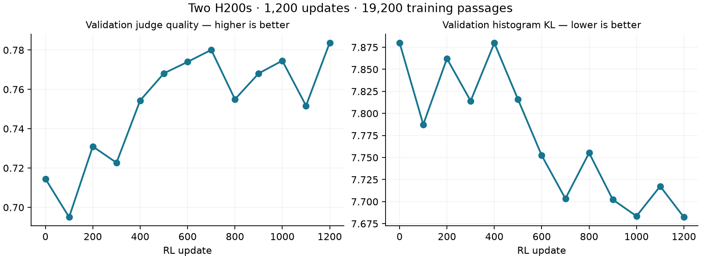

# StochTune

Investigating distributional fidelity in language-model generation: numeric draws from requested probability laws, and coherent passages whose aggregate word or word-bigram statistics follow a reference corpus.

This repository records completed **numeric SFT, numeric batch-KL RL, Shakespeare passage RL, and HelpSteer human-preference/word-distribution experiments**. The latest implementation matches **question-conditioned semantic embedding distributions with MMD**. Its first run completed with a small, statistically uncertain distribution improvement and slightly lower quality. Subsequent kCGM-inspired changes passed CPU replay checks; GPU comparison job **508718** is queued, with no new policy results yet. The original mathematical overview is retained below. The optional direct soft-target KL trainer is implemented but has not been run.

See [References and acknowledgments](#references-and-acknowledgments) for the papers, original blog, datasets, models, and implementations informing this work.

## What has actually been run

| Stage | Starting policy and signal | Completed budget | Outcome |
|---|---|---|---|
| Numeric SFT | Qwen2.5-3B base; cross-entropy on target-distribution samples | 2,000 updates; 64,000 examples; one H200 | Large improvement in numeric formatting and sampling metrics |
| Numeric RL | Numeric SFT adapter; negative empirical histogram KL | 250 updates; 128,000 generated responses; one H200 | Mean held-out KL 2.2% lower; mixed transfer |
| Passage judge audit | Frozen 7B instruction model; controlled text perturbations | 48 passages; corrected dimension-wise scoring | Initial JSON protocol missed 22 task scores; corrected scorer passed 18 predefined perturbation checks |
| Short passage RL | Fresh Qwen2.5-3B-Instruct; quality + bigram matching | 100 updates; 1,600 passages; one H200 | No clear held-out improvement |
| Longer passage RL | Fresh Qwen2.5-3B-Instruct; same reward, broader prompts, DDP | 1,200 updates; 19,200 passages; two H200s | Higher judge scores; small reduction in empirical bigram KL |
| Unigram passage RL | Same starting model, judge, prompts, and coefficients; single-word KL reward | 1,097 updates; 17,552 passages; two H200s | Better measured word-frequency matching; quality improved over base, slightly below bigram run |
| HelpSteer subset RL | Human-preference reward model; quality-only and unigram KL with λ = 0.1 / 0.5 | 200 updates per arm; 32 final responses per policy | No convincing joint quality/distribution gain |
| Corrected broad HelpSteer RL | Audited frozen Skywork 8B reward; 4,948-answer word PMF; λ = 0.5 | 86 updates; 1,376 training responses; two H200s | Quality reward increased; unigram KL worsened |
| Programming unigram RL | Programming-only references; frequent words + OTHER; same frozen reward | 75 updates; 1,200 training responses; two H200s | Target KL improved by only 0.7%; quality point estimates declined slightly |
| Conditional semantic MMD | Four questions × four answers; two human-rated reference prototypes per exact question | Completed job 504124; two H200s, 81m36s | MMD 0.3922 → 0.3833; quality 0.6696 → 0.6631; uncertain changes |
| Direct soft-target KL | Trie-derived next-token targets | Implemented, not run | No measured results |

The passage runs use actual on-policy REINFORCE updates to LoRA weights. The Shakespeare quality scorer is a frozen instruction-model judge, without preference training in this project. The later HelpSteer stages use a trained Bradley–Terry scorer or an audited pretrained reward model. Generated-answer evaluations remain **model-judged, not human-validated outcomes**.

## HelpSteer results and conditional semantic MMD

The completed HelpSteer runs do not establish successful joint control of writing
quality and reference-word frequencies. They motivate changing the target from a
pooled vocabulary across unrelated questions to a distribution conditioned on
each exact question. Full metrics, baseline/final generations, training histories,
scorer audits, configs, and source hashes are recorded in
[results/helpsteer-v1](results/helpsteer-v1/README.md).

### Completed broad-domain and programming experiments

Each column pair below compares its own initial/final policy on 32 held-out
questions × four responses. **The two experiments use different questions,
reference corpora, and vocabularies; their absolute KL values are not a common
cross-experiment benchmark.** Both use λ = 0.5 and initial-policy KL coefficient
β = 0.002, with temperature 1, top-p 1, and top-k disabled.

| Metric | Broad: initial | Broad: final | Programming: initial | Programming: final |
|---|---:|---:|---:|---:|
| Optimized word-PMF KL ↓ | 1.9163 | 1.9923 | 0.5920 | 0.5880 |
| Full-vocabulary KL ↓ | 1.9163 | 1.9923 | 1.0729 | 1.0674 |
| Frozen quality reward ↑ | 0.5432 | 0.5674 | 0.6641 | 0.6585 |
| Independent coherence /5 ↑ | 4.023 | 4.080 | 4.510 | 4.464 |
| Independent readability /5 ↑ | 4.045 | 4.081 | 4.319 | 4.283 |
| Independent fulfillment /5 ↑ | 4.055 | 4.112 | 4.614 | 4.541 |
| Mean words per answer | 227.3 | 206.7 | 434.4 | 432.6 |

The broad run uses 4,948 preferred training references with 30,078 word types.
It completed 86 updates; its pooled unigram KL increased despite an improvement
in the reward model's quality score. The programming run uses 228 reference
answers, retaining 1,589 words occurring at least five times and preserving the
remaining 8.2% reference mass in OTHER. It completed 75 updates in **1h25m38s**
including saving and evaluation. Generated OTHER mass increased from 22.8% to
23.3%, and 20/128 final answers reached the generation cap. Its very small KL
reduction is not convincing evidence of reliable learning.

The corrected policy reward uses frozen
`Skywork/Skywork-Reward-V2-Qwen3-8B`. On the model-selection audit it reached
78.75% non-tied human-preference accuracy and passed the predefined engineering
gates; the legacy 3B scorer reached 67.14% and failed. This audit selected the
scorer, is not an independent final benchmark, and cannot rule out upstream
HelpSteer overlap. A separate Qwen2.5-7B-Instruct supplies final coherence,
readability, and fulfillment ratings; neither set of generated answers has human
quality labels.

- [Original HelpSteer preference/RL implementation](experiments/helpsteer-rl/README.md)
- [Corrected length handling, scorer audit, and broad PMF](experiments/helpsteer-rl-v2/README.md)
- [Programming selection, frequent-word PMF, and OTHER mathematics](experiments/helpsteer-programming/README.md)
- [Programming run on W&B](https://forge.coreweave.com/wandb/yash2007-university-of-washington/stochastic-llm/runs/d6hs9j2z)

### Conditional semantic-MMD objective and completed first run

The new experiment uses **102 training, 10 validation, and 19 test questions**,
retaining questions with two distinct model-written answers whose human
coherence, helpfulness, and correctness ratings are all at least 3/4. It keeps
the existing splits and assigns equal weight to those two reference prototypes.
They do not establish the true frequencies of every valid answer type.
No new teacher is trained or sampled.

Let `X_qa` be the frozen reference embeddings and `Z_qi` the embeddings of sampled
student answers to the same exact question. With `m = 2` fixed references and
`n = 4` independent student answers, the implemented cost is:

```math
\widehat d_q=
\frac{1}{n(n-1)}\sum_{i\ne j}k(Z_{qi},Z_{qj})
+\frac{1}{m^2}\sum_{a,b}k(X_{qa},X_{qb})
-\frac{2}{nm}\sum_{i,a}k(Z_{qi},X_{qa}).
```

The generated U-statistic excludes its diagonal; the fixed-reference V-statistic
includes its diagonal. The resulting estimate is unbiased for population MMD²
against this **fixed empirical reference measure**, assuming independent
conditional generation. It can be negative in finite samples and is not clipped.
It does not estimate distance to an unknown population of all valid human answers.

The batch contains four distinct questions, each with four answers. The objective
averages `mean(quality) − 0.5 × MMD²` equally across questions, with the same
β = 0.002 initial-policy regularizer. Passage distribution credit is
`n × [MMD²(without answer i) − MMD²(full question group)]`; quality leave-one-out
baselines also remain within their question. This is on-policy REINFORCE with
leave-one-out credit, without PPO clipping, GRPO normalization, or a learned critic.

The frozen, pinned MiniLM encoder processes every 256-token chunk of each answer;
chunk vectors are pooled without discarding the tail. A mixture of three Gaussian
kernels uses bandwidth calibrated from training references only. The original
word-PMF KL remains an evaluation diagnostic and does not enter the MMD reward.
Matching semantic features does not guarantee lower lexical KL or correct code.

**Job 504124 completed** with 94 updates and 1,504 sampled answers in
**81 minutes 36 seconds on two H200s**. On 19 test questions, MMD changed
0.39224 → 0.38330 and quality reward 0.66961 → 0.66314. Paired prompt-bootstrap
95% intervals for final-minus-baseline changes were [-0.03421, 0.01611] for MMD
and [-0.04043, 0.02798] for quality. These results do not establish an overall gain.

The subsequent [kCGM-inspired CPU audit](results/helpsteer-v1/kcgm-cpu-audit/README.md)
adds exact-question KL centering, frozen scale calibration, and an energy-distance
kernel. Replay shows calibrated distribution coefficients comparable to quality
coefficients, with Gaussian/energy credit correlation 0.951. These changes have
**not** produced a new trained-policy result. Their GPU comparison is queued as **job 508718**: Gaussian then energy distance in one **two-H200, two-hour maximum allocation** (up to four GPU-hours), with **45 minutes of training per variant**, evaluation time, and required online W&B logging. Both start from the same pinned actor and reuse the frozen quality scorer; there is no reward-model or teacher training.

The calibrated objective to minimize is

```math
L(\theta)=\frac{-\mathbb E[r_{\mathrm{quality}}]+0.5s_k D_k(\pi_\theta,P)
+0.002D_{\mathrm{KL}}(\pi_\theta\|\pi_0)}{1.502},
```

with frozen scales `s_rbf = 2.29718` and `s_energy = 1.77101`, fitted on the
first ten saved training updates. The KL policy-gradient coefficient subtracts
the other same-question answers’ mean log-ratio. The energy kernel is
`k(x,y) = −||x−y||`, avoiding Gaussian bandwidth selection. Exact-gradient and
DDP checks passed; these are existing kCGM ideas adapted to our conditional
text experiment, not a claim of a new estimator. See the audit for limitations.

- [Completed first MMD run: metrics, samples, and configuration](results/helpsteer-v1/semantic-mmd/)
- [Queued comparison: exact submitted profiles, budget, and Slurm script](results/helpsteer-v1/kcgm-gpu-comparison/)
- [Full MMD mathematics, implementation, limitations, and run protocol](experiments/helpsteer-semantic-mmd/README.md)
- [Recorded CPU checks and submitted-job snapshot](results/helpsteer-v1/semantic-mmd-preparation/)

CPU preparation can be rebuilt from the pinned public dataset. The embedding
checkpoint must be cached before the offline semantic preparation:

```bash
python experiments/helpsteer-rl-v2/prepare.py --raw outputs/helpsteer-data/raw
python experiments/helpsteer-programming/prepare.py
python -c "from huggingface_hub import snapshot_download; snapshot_download('sentence-transformers/all-MiniLM-L6-v2', revision='1110a243fdf4706b3f48f1d95db1a4f5529b4d41')"
python experiments/helpsteer-semantic-mmd/prepare.py
python -m unittest discover -s experiments/helpsteer-semantic-mmd -p 'test_mmd.py' -v
```

Preparation never submits a GPU job. Checkpoints, optimizer states, credentials,
downloaded models, raw training caches, and local deployment archives remain
outside Git. Results retain the pinned HelpSteer2 attribution and provenance.

## Unigram versus bigram passage RL

The completed unigram run changes only the distribution target from adjacent
word pairs to single words. It reuses the quality reward: the frozen
Qwen2.5-7B-Instruct judge scores coherence, fluency, and prompt fulfillment.
Both runs start fresh from the same pinned Qwen2.5-3B-Instruct model and use
the same prompts, seed, decoding settings, LoRA, and optimization settings.
The final test contains the same 16 held-out scenarios, four passages each.

| Held-out metric | Initial policy | Bigram-trained | Unigram-trained |
|---|---:|---:|---:|
| Unigram KL ↓ | 3.0598 | 2.7766 | **2.5876** |
| Bigram KL ↓ | 8.0710 | 7.9282 | **7.8699** |
| Quality reward /1 ↑ | 0.7419 | **0.8029** | 0.7874 |
| Judge coherence /5 ↑ | 3.8499 | **3.9985** | 3.9821 |
| Judge fluency /5 ↑ | 3.9618 | **4.0354** | 4.0285 |
| Judge prompt fulfillment /5 ↑ | 4.0913 | **4.6011** | 4.5827 |
| Words absent from reference ↓ | 11.37% | 9.66% | **7.88%** |
| Mean words per passage | 96.88 | 115.52 | 137.17 |
| Responses ending with EOS | 64/64 | 64/64 | 63/64 |

Unigram training reduced raw unigram KL by **15.4%** relative to the initial
policy and improved mean judge quality on **14/16 test prompts**. Its quality
reward is slightly below the bigram run, with eight prompts better and eight
worse. An exploratory paired-prompt bootstrap interval for this quality
difference includes zero; this does not establish a quality winner.

Longer outputs change histogram sample counts. Matching each policy to **6,200
word observations**, averaged over 200 subsamples without replacement, gives
unigram KL **3.0598 → 2.8589 → 2.7006** for initial, bigram-trained, and
unigram-trained policies. The unigram advantage remains about **5.5%** relative
to the bigram-trained policy. This diagnostic ignores passage dependence and
does not eliminate sparse-histogram estimation bias.

The unigram job **499702** completed successfully in **1h45m57s on two H200s**
(about **3.53 GPU-hours**). It stopped at the 105-minute training budget after
1,097 updates, then saved and evaluated; the bigram run reached 1,200 updates.
The schedules were configured identically, but actual update counts differ.
No lambda sweep was performed. Both use **lambda = 0.1** and initial-policy
KL coefficient **beta = 0.002**.

**Interpretation:** a positive distribution-control result with improved
judge-rated quality over the base model. Single-word matching gives better
measured frequency fit while retaining most of the bigram run's quality gain.
This is one seed with one reward/evaluation judge, no human validation, and
only 16 templated test scenarios. A better quality reward is a hypothesis to
test, not an improvement demonstrated by this run.

- [Unigram methods, results, and reproduction](results/passage-unigram-v1/README.md)
- [All saved test/validation passages and training metrics](results/passage-unigram-v1/)
- [Count-matched and prompt-bootstrap diagnostics](results/passage-unigram-v1/final-diagnostics.json)
- [W&B unigram run](https://forge.coreweave.com/wandb/yash2007-university-of-washington/stochastic-llm/runs/77envg9c)

## Completed bigram passage-RL results

The longer run starts from the pinned **Qwen2.5-3B-Instruct** checkpoint, not the numeric adapter or the final short-run adapter. It generates complete 80–120-word dramatic monologues. Word bigrams are measured across the generated collection; word pairs are not independently concatenated to construct the prose.

The final adapter and the original instruction policy were evaluated on the same **16 held-out scenarios × 4 generations = 64 passages per policy**, with matching decoding settings and per-rank sampling seeds. The original policy is recovered by disabling LoRA; its base weights remain frozen during training.

| Held-out metric | Before passage RL | After 1,200 updates |
|---|---:|---:|
| Pooled bigram KL ↓ | 8.0710 | **7.9282** |
| Judge coherence /5 ↑ | 3.8499 | **3.9985** |
| Judge fluency /5 ↑ | 3.9618 | **4.0354** |
| Judge prompt fulfillment /5 ↑ | 4.0913 | **4.6011** |
| Combined quality reward /1 ↑ | 0.7419 | **0.8029** |
| Out-of-reference bigram rate ↓ | 63.51% | **56.15%** |
| Mean words per passage | 96.88 | 115.52 |
| Responses ending with EOS | 64/64 | 64/64 |

Raw pooled bigram KL fell **1.77%**. Mean judge quality improved on **15 of 16 prompts**, with the largest change in prompt fulfillment. Both policies terminated every test response, so this quality gain is not the truncation artifact observed in the short run. The shorter run's KL was 7.9903 → 7.9935 and showed no clear improvement; its different prompt set prevents a compute-only comparison with the longer experiment.

The longer run completed in **1h41m21s on two H200s**, approximately **3.38 GPU-hours**, within a two-hour allocation / four-GPU-hour cap. It reached its 1,200-update limit rather than stopping on the time budget.



Validation uses 32 passages; final test evaluation uses 64. Their absolute KL values are not directly comparable. Final outputs are about 19.2% longer, which changes the number of observed bigrams. A post hoc count-matched diagnostic still found a small reduction (8.0710 → 7.8762); it is a sampling-sensitivity check, not a correction proving exact distribution matching.

**Interpretation:** a modest positive result under this frozen judge and a small improvement in aggregate word-pair statistics. One training seed, one judge shared between reward and evaluation, only 16 templated test scenarios, and biased sparse histogram estimates limit the conclusion. Some samples remain awkward. The experiment does not establish high-quality Shakespearean writing, exact corpus sampling, absence of memorization, or superiority to continued SFT or MaD-RL.

- [Full passage report, diagnostics, and a matched sample pair](results/passage-rl-v1/ddp/RESULTS.md)
- [All 128 baseline/final test passages](results/passage-rl-v1/ddp/) and [training history](results/passage-rl-v1/ddp/history.jsonl)
- [Short-run results](results/passage-rl-v1/pilot/comparison.json) and [judge-audit records](results/passage-rl-v1/)
- [Detailed method and reproduction](docs/passage-rl-experiment.md)
- [W&B main DDP run](https://forge.coreweave.com/wandb/yash2007-university-of-washington/stochastic-llm/runs/zop09jj3) · [final analysis](https://forge.coreweave.com/wandb/yash2007-university-of-washington/stochastic-llm/runs/3buboztw)

## Passage-RL mathematics and implementation

### Reference and generated bigram distributions

The reference is the first 80% of eligible paragraphs from a pinned Tiny Shakespeare text snapshot. Eligible paragraphs have at least ten normalized words. Words are lowercased, internal apostrophes are retained, punctuation is excluded, and speaker-name words are retained. Counts do not cross paragraph boundaries. This is a discrete probability mass function, not a continuous density:

```math
p_b = \frac{C_{\mathrm{ref}}(b)}{\sum_{b'} C_{\mathrm{ref}}(b')},
\qquad p_{\mathrm{UNKNOWN}}=0.
```

There are 83,454 observed reference word pairs plus an UNKNOWN category. For a generated batch of passages $\mathcal B=(Y_1,\ldots,Y_N)$, let $n_i(b)$ count pair $b$ in passage $i$, and let $M=\sum_i\sum_b n_i(b)$. Unseen pairs contribute to UNKNOWN; an empty or one-word passage contributes one UNKNOWN observation. Generated passages are never joined to create boundary bigrams. With $B=83{,}455$ categories and total pseudocount mass $\eta=1$:

```math
a=\frac{\eta}{B},\qquad
\widehat q_b(\mathcal B)=\frac{\sum_i n_i(b)+a}{M+\eta},
\qquad
G(\mathcal B)=-\sum_{b:p_b>0}p_b\log\frac{p_b}{\widehat q_b(\mathcal B)}.
```

All generated pairs remain in the denominator. This is a smoothed, finite-batch approximation; matching it does not determine long-range meaning or all within-passage structure.

### Frozen quality reward

A pinned **Qwen2.5-7B-Instruct** evaluates coherence, fluency, and prompt fulfillment separately. It is asked for a rating from 1 to 5. Instead of parsing generated JSON, the corrected scorer reads the next-token probabilities of those five single-token digits. For dimension $d$, with frozen judge $\rho_\phi$:

```math
s_d(Y,c)=\sum_{k=1}^{5} k\,
\frac{\rho_\phi(k\mid d,c,Y)}{\sum_{j=1}^{5}\rho_\phi(j\mid d,c,Y)},
\qquad
r_Q(Y,c)=\mathbf 1_{\mathrm{EOS}}\,
\frac{\left(s_{\mathrm{coherence}}+s_{\mathrm{fluency}}+s_{\mathrm{task}}\right)/3-1}{4}.
```

The rating is conditional on those five tokens, not a calibrated human score. Their total original probability is recorded; mass below 0.01 causes failure. A truncated passage gets zero positive quality reward but still contributes its observed word pairs to the histogram. Style ratings from the initial audit do not enter the training reward. The corrected scorer passed predefined corruption checks, which do not substitute for human preference validation.

### Joint objective, coefficients, and credit assignment

With $\pi_0$ the initial instruction policy, the objective combines mean passage quality, aggregate bigram matching, and a separate reverse sequence-KL stability penalty:

```math
J(\theta)=
\mathbb E_{\mathcal C,\,\mathcal B\sim\pi_\theta}
\left[\frac1N\sum_{i=1}^{N}r_Q(Y_i,c_i)+\lambda G(\mathcal B)\right]
-\beta\,\mathbb E_c D_{\mathrm{KL}}\!\left(\pi_\theta(\cdot\mid c)\|\pi_0(\cdot\mid c)\right),
\qquad \lambda=0.1,\quad\beta=0.002.
```

The reference-policy KL is different from the target-bigram KL. **λ = 0.1 was a heuristic starting value; no λ sweep has been run.** The reward weights were identical in the short and longer passage experiments.

Write $\ell_i=\log\pi_\theta(Y_i\mid c_i)$ and $\ell_i^0=\log\pi_0(Y_i\mid c_i)$, summing completion-token log probabilities including EOS when present. The implementation assigns:

```math
A_i^Q=r_Q(Y_i,c_i)-\frac{1}{N-1}\sum_{j\ne i}r_Q(Y_j,c_j),
\qquad
A_i^D=N\left[G(\mathcal B)-G(\mathcal B\setminus\{Y_i\})\right],
```

```math
A_i=A_i^Q+\lambda A_i^D-\beta(\ell_i-\ell_i^0),
\qquad
\mathcal L_{\mathrm{RL}}=-\frac1N\sum_i\operatorname{stopgrad}(A_i)\,\ell_i.
```

Removing a passage removes all its overlapping bigrams and recomputes the denominator. The factor $N$ compensates for averaging sequence losses. There is no GRPO normalization, PPO clipping, learned value critic, or gradient through the frozen judge. The score-function estimator targets the expected finite-batch reward; it is not an unbiased estimator of exact population bigram KL. Dropout is disabled and each generated group is used for one update.

### What DDP and the longer schedule change

The longer run uses 256 training scenarios, 16 validation scenarios, and 16 test scenarios, generated from disjoint role/setting/dilemma pools. These are synthetic combinations, not 256 independently authored stories. Each update chooses two training scenarios and generates eight passages for each: **global group size 16**. Each GPU hosts an actor and frozen judge and processes eight passages. Both ranks contribute to one histogram and one leave-one-out quality baseline; rank zero broadcasts the combined credits.

DDP averages the two locally averaged gradient estimates, preserving the global mean:

```math
\frac12\left(\frac18\sum_{i\in\mathrm{rank}\,0}g_i+
\frac18\sum_{i\in\mathrm{rank}\,1}g_i\right)
=\frac1{16}\sum_{i=1}^{16}g_i.
```

Only attention LoRA weights train: rank 16, alpha 32, dropout 0, BF16 base models, AdamW learning rate $5\times10^{-6}$, 40 warmup updates, cosine decay over 1,200 updates, and gradient norm clipping at 1. Global batch size and learning rate are not doubled for DDP. Decoding uses temperature 1, top-p 1, top-k disabled, and at most 256 new tokens.

Validation and complete checkpoints run every 100 updates. Checkpoints save adapter, optimizer/scheduler, prompt-selection RNG, both ranks' RNG states, and source/config hashes. The two-hour allocation has no automatic requeue; training has a 105-minute cutoff to reserve final evaluation and saving time. No extra GPU benchmark preceded the DDP run. CPU tests verify global reward/gradient equivalence and checkpoint restoration.

### Reproduce the recorded passage analysis without a GPU

```bash
python -m pip install -e '.[dev,analysis]'
python experiments/shakespeare-quality-pilot/analyze_recorded.py
python -m unittest discover -s experiments/shakespeare-quality-pilot -p 'test_*.py' -v
```

The analysis reads committed samples and corpus counts; it does not generate text or allocate GPUs. Full training rollouts, final adapters, and source artifacts are available through the W&B run. Model weights, optimizer states, environments, and credentials remain outside Git. See [the passage guide](docs/passage-rl-experiment.md) for training commands and the [results manifest](results/passage-rl-v1/manifest.json) for checksums and provenance.

## Completed KL-reward RL results

The final 250-update RL adapter and its starting SFT adapter were evaluated on the same **100 held-out prompts × 1,000 generations per prompt**, using identical decoding settings. Lower distribution distances are better.


| Metric | SFT | SFT + KL-reward RL | Relative reduction |
|---|---:|---:|---:|
| Mean histogram KL | 0.2277 | 0.2226 | 2.2% |
| Median histogram KL | 0.1191 | 0.1057 | 11.3% |
| Median KS distance | 0.1392 | 0.1268 | 8.9% |
| Median normalized Wasserstein distance | 0.1122 | 0.1013 | 9.8% |
| Numeric-only responses with EOS | 98.68% | 98.59% | — |

This is a modest incremental improvement: KL improved on 61 of 100 prompts. Normal and uniform improved on median KS; exponential and Weibull regressed. The unseen-family aggregate worsened slightly on median KS and Wasserstein. One training seed and no equal-compute SFT continuation control limit conclusions.

The algorithm is on-policy **REINFORCE with a leave-one-out batch reward baseline**, not PPO or GRPO. It optimizes negative smoothed forward histogram KL with a separate reference-policy KL penalty. The run used 128,000 sampled training responses and took **22m34s** on one H200; evaluation took **5m43s**. Test histogram KL is computed post hoc from 1,000 draws, whereas training/validation groups contain 256; their absolute KL values are not directly comparable.

- [Full RL report](results/rl-v1/analysis/RESULTS.md)
- [Implementation, hyperparameters, and reproduction](docs/kl-rl-experiment.md)
- [Recorded results, all SFT/RL test generations, and training history](results/rl-v1/)
- [W&B comparison dashboard](https://forge.coreweave.com/wandb/yash2007-university-of-washington/stochastic-llm/runs/lyb3xv9l)
- [W&B RL training](https://forge.coreweave.com/wandb/yash2007-university-of-washington/stochastic-llm/runs/tx91cho0)
- [W&B final evaluation](https://forge.coreweave.com/wandb/yash2007-university-of-washington/stochastic-llm/runs/n9d9aegn)

## SFT results

Both checkpoints were evaluated on the same **100 held-out prompts × 1,000 independent generations**, for 200,000 model responses in total.


| Metric | Pretrained base | After SFT |
|---|---:|---:|
| Numeric-only responses, terminated with EOS | 6.84% | **98.68%** |
| Median normalized Wasserstein distance ↓ | 1.6858 | **0.1122** |
| Median KS distance ↓ | 0.5428 | **0.1392** |
| Out-of-support values among numeric responses | 19.87% | **1.35%** |

Lower distribution distances are better. Wasserstein is normalized by the target's 95th–5th percentile width; KS is the largest gap between the empirical and target cumulative distributions. Medians aggregate prompts.

For normal distributions, median KS improved from **0.2613 to 0.0763**. For held-out Weibull and Poisson families combined, it improved from **0.4016 to 0.1696**.

The result is encouraging, but calibration remains imperfect: a direct SciPy reference produced median KS **0.0247** and normalized Wasserstein **0.0113**, using matched valid sample counts and 20 repetitions per case.

### How to interpret these results

- Formatting is a substantial confound: 88.6% of base responses reached the 32-token limit. A format-matched control is needed to isolate the calibration effect.
- Distribution distances use only valid numeric responses, including out-of-support values. Four base prompts had no valid answers and are excluded from its distance medians.
- Numeric validity requires one finite number and EOS; it does not guarantee the number lies within the target's support.
- One training seed was used. These tests do not establish exact sampling, independence, general language retention, or an effect specifically attributable to RLHF.

## Experiment at a glance

| Setting | Value |
|---|---|
| Base model | [`Qwen/Qwen2.5-3B`](https://huggingface.co/Qwen/Qwen2.5-3B) |
| Training data | 64,000 examples: 2,000 parameter configurations × 32 draws |
| Training families | Normal, uniform, exponential, beta, gamma, binomial |
| Held-out families | Weibull, Poisson |
| Adaptation | LoRA rank 16, alpha 32, dropout 0.05 |
| Optimizer / learning rate | AdamW / `2e-4` |
| Training budget | 2,000 updates, effective batch size 32, one epoch |
| Hardware / precision | One NVIDIA H200 / BF16 |
| Training job time | 4m50s, including a 4m14s training loop |

Evaluation used temperature 1, top-p 1, top-k disabled, and no repetition penalty. Tests cover unseen parameter ranges, held-out distribution families, and new prompt wording. Invalid responses were not repaired or resampled.

## Numeric code and recorded artifacts

The repository includes the SFT training/evaluation pipeline, pinned configs, per-prompt results, the numerical-sampler reference, and the two plotted cases' raw generation logs.

- [Full SFT setup, reproduction commands, and limitations](docs/sft-experiment.md)
- [Recorded metrics and provenance](results/sft-v1/)
- [Per-prompt base results](results/sft-v1/base/results.csv) · [Per-prompt SFT results](results/sft-v1/sft/results.csv)
- [Download the figure as PDF](results/sft-v1/sampling-results.pdf)
- [W&B results dashboard](https://forge.coreweave.com/wandb/yash2007-university-of-washington/stochastic-llm/runs/zkuvylag)
- [W&B training run](https://forge.coreweave.com/wandb/yash2007-university-of-washington/stochastic-llm/runs/xcj01bg1)

Full raw generations and trained adapter artifacts are stored with the W&B runs. Model weights, credentials, environments, and scheduler logs are not checked into Git.

### Inspect the results locally

```bash
python3.12 -m venv .venv
source .venv/bin/activate
python -m pip install -e '.[dev,analysis]'
python -m pytest -q
python scripts/analyze_results.py
```

The analysis command regenerates the figure from the committed results without a GPU. Tests use a tiny local model and offline tracking. Training the full checkpoint requires CUDA; see the [SFT reproduction guide](docs/sft-experiment.md).
## Original technical overview and equations

The following retains the original research formulation. The completed implementation uses this batch-KL reward with a leave-one-out baseline and a separate reference-policy KL penalty; measured SFT and RL results are reported above.

---

# StochTune
Trying to make a LLM that can potentially generate numbers pseudo-randomly from some target distribution


### Information
# Training LLMs to Sample from Probability Distributions

This project investigates whether a language model can learn to generate numbers according to a requested probability distribution.

The goal is **distributional fidelity**: repeated, independent responses should have the correct frequencies, spread, and tail behavior.

For example, given:

> Sample exactly one number from a normal distribution with mean 0 and standard deviation 1.

Repeated responses should approximately follow:

```math
X \sim \mathcal{N}(0,1).
```

Generating individual numbers that look plausible is insufficient. Correct sampling is a property of the distribution of responses across many requests.

## Research Question

Can fine-tuning with a reward based on distributional mismatch teach an LLM to become a better conditional sampler?

We investigate generalization to:

- Unseen parameters of familiar distributions.
- Distribution families absent from training.
- Different prompt wording.
- Eventually, explicitly defined distributions over nonnumeric choices.

## Problem Formulation

Let:

- $c$ denote a prompt specifying a distribution and its parameters.
- $p(x \mid c)$ denote the requested target distribution.
- $\pi_\theta(y \mid c)$ denote the probability of generating response $y$.
- $f(y)$ parse a response into a number, or return $\bot$ for an invalid response.

The model induces an output distribution:

```math
q_\theta(x \mid c)
=
\sum_{y:f(y)=x} \pi_\theta(y \mid c).
```

Our objective is to bring this induced distribution closer to the requested target.

## Batch-Level KL Reward

For each prompt, generate $N$ independent responses:

```math
Y_1,\ldots,Y_N
\overset{\mathrm{iid}}{\sim}
\pi_\theta(\cdot \mid c),
\qquad
X_i=f(Y_i).
```

Each response is generated from a fresh context containing the same prompt.

### Discretizing the Target

We compare probability masses over bins rather than directly comparing an empirical sample with a continuous density.

For numeric bins $B_1,\ldots,B_K$, define:

```math
p_j(c) = \Pr(X \in B_j \mid c).
```

For a continuous target with density $p(x \mid c)$:

```math
p_j(c) = \int_{B_j} p(x \mid c)\,dx.
```

Add an invalid-output category, indexed by $\bot$, with target probability:

```math
p_\bot(c)=0.
```

Malformed responses, unfinished responses, and values outside the distribution's support are assigned to this category.

### Estimating the Model Distribution

Let $n_j$ be the number of generated responses assigned to category $j$.

Using additive smoothing with $\alpha>0$:

```math
\widehat{q}_j
=
\frac{n_j+\alpha}{N+\alpha(K+1)}.
```

Smoothing prevents an unobserved target bin from producing an infinite KL estimate.

### Reward Function

The batch reward is the negative forward KL divergence:

```math
R(c,Y_{1:N})
=
-D_{\mathrm{KL}}\!\left(
p(\cdot \mid c)
\,\middle\|\,
\widehat{q}
\right).
```

Explicitly:

```math
D_{\mathrm{KL}}(p\|\widehat{q})
=
\sum_{j:p_j>0}
p_j \log\frac{p_j}{\widehat{q}_j}.
```

**Higher reward means closer agreement with the target distribution.**

Invalid responses remain in the sample count and normalization. Discarding them before computing the reward would hide poor response validity.

## Reinforcement Learning Objective

We maximize expected batch reward:

```math
J(\theta)
=
\mathbb{E}_{c}
\mathbb{E}_{Y_{1:N}\sim\pi_\theta}
\left[R(c,Y_{1:N})\right].
```

A policy-gradient estimator is:

```math
\nabla_\theta J
=
\mathbb{E}\left[
\sum_{i=1}^{N}
(R-b_i)
\nabla_\theta \log\pi_\theta(Y_i \mid c)
\right].
```

One possible baseline is a leave-one-out reward:

```math
b_i = R(c,Y_{-i}),
```

computed by removing response $i$ and recomputing the histogram and its normalization.

The corresponding sampled loss is:

```math
\mathcal{L}_{\mathrm{RL}}
=
-\sum_{i=1}^{N}
\mathrm{stopgrad}(R-b_i)
\log\pi_\theta(Y_i \mid c).
```

The reward is computed from generated numbers, while gradients flow through the probabilities of their generated token sequences.

A shared batch reward must not simply be mean-centered within that same batch: identical rewards would produce zero advantages.

## Experimental Comparisons

We distinguish three training approaches:

| Method | Training signal |
|---|---|
| Sampled-target SFT | Cross-entropy on answers sampled from the target distribution |
| Direct KL supervision | Match target next-token probabilities |
| Batch-reward RL | Reward distributions estimated from the model's own generated samples |

The proposed RL experiment starts from the SFT checkpoint to investigate improvements beyond the existing formatting and sampling baseline.

The initial model is **Qwen2.5-3B**, adapted using **LoRA**.

## Evaluation

We evaluate independent samples using:

- Numeric response validity.
- Support violations.
- Empirical CDFs and quantile coverage.
- Kolmogorov–Smirnov distance.
- Wasserstein distance.
- Tail behavior and repeated-value concentration.

A conventional numerical sampler provides a reference for the error expected from finite samples.

Evaluation uses held-out prompts and parameters. Improvement on the training reward alone does not establish accurate sampling.

## Limitations

The reward measures agreement at the chosen bin resolution. It cannot fully detect errors within bins, and finite batches introduce estimation noise and smoothing bias.

Matching the training histogram is therefore insufficient: evaluation must also examine finer distributional structure.

The objective is calibrated use of inference-time sampling randomness. It does not guarantee exact continuous sampling, cryptographic randomness, or a new source of entropy.


## References and acknowledgments

These sources informed the motivation, implementation, evaluation, and related-work
comparisons. Each entry states its role; citing a method does not mean this repository
implements it or reproduces its results. Exact dataset/model revisions used in our
runs are recorded in their configurations and source manifests.

### Controlled stochasticity and distribution matching

| Reference | Role in StochTune |
|---|---|
| Kuriakose & Baldelli (2026), [Training Language Models for Controlled Stochasticity](https://www.lesswrong.com/posts/upCrcE39aF63GoLJh/training-language-models-for-controlled-stochasticity-2) | Original user-supplied blog motivating learned stochastic generation and distributional fidelity. |
| Baldelli et al. (2026), [Probabilistic Calibration Is a Trainable Capability in Language Models](https://arxiv.org/abs/2605.11845) | Calibration Fine-Tuning reference: sampled-target supervision and trie-derived soft targets. Our numeric SFT and implemented-but-unrun direct soft-target trainer relate to these two approaches; our batch-reward RL uses a different objective. |
| Diamant & Trippe (2026), [Calibrating Generative Models to Feature Distributions with MMD Finetuning](https://arxiv.org/abs/2606.19496) · [author code](https://github.com/smithhenryd/cgm) | Close prior work for MMD distribution matching with coupled leave-one-out policy gradients and initial-policy KL. Its implementation informed KL centering, frozen scale calibration, and the energy-distance comparison. These components are not claimed as new estimators. |
| Gretton et al. (2012), [A Kernel Two-Sample Test](https://jmlr.org/papers/v13/gretton12a.html) | MMD foundations and sample estimators underlying our conditional semantic-distribution objective. |
| Sejdinovic et al. (2013), [Equivalence of distance-based and RKHS-based statistics in hypothesis testing](https://arxiv.org/abs/1207.6076) | Mathematical background for the relationship between energy distance and kernel discrepancies in the Gaussian-versus-energy comparison. |

### Policy gradients and preference rewards

| Reference | Role in StochTune |
|---|---|
| Williams (1992), [Simple statistical gradient-following algorithms for connectionist reinforcement learning](https://doi.org/10.1007/BF00992696) | REINFORCE / score-function policy-gradient foundation. |
| Ahmadian et al. (2024), [Back to Basics: Revisiting REINFORCE Style Optimization for Learning from Human Feedback in LLMs](https://arxiv.org/abs/2402.14740) | REINFORCE with leave-one-out baselines in LLM post-training. Our distribution reward additionally couples multiple generated answers. |
| Bradley & Terry (1952), [Rank Analysis of Incomplete Block Designs: I. The Method of Paired Comparisons](https://doi.org/10.1093/biomet/39.3-4.324) | Pairwise preference model underlying the legacy HelpSteer reward-training loss. |
| Ouyang et al. (2022), [Training language models to follow instructions with human feedback](https://arxiv.org/abs/2203.02155) | User-supplied RLHF reference for human rankings, reward modeling, and policy optimization. Our updater uses REINFORCE rather than this paper's PPO recipe. |
| Hu et al. (2021), [LoRA: Low-Rank Adaptation of Large Language Models](https://arxiv.org/abs/2106.09685) | Adapter parameterization used to fine-tune the actors and legacy reward model. |

### Quality evaluation and human-feedback data

| Reference | Role in StochTune |
|---|---|
| Liu et al. (2023), [G-Eval: NLG Evaluation using GPT-4 with Better Human Alignment](https://arxiv.org/abs/2303.16634) | Reference for rubric-based, probability-weighted LLM evaluation. Our Qwen dimension-wise judge is a project-specific adaptation, not a reproduction of G-Eval. |
| Zheng et al. (2023), [Judging LLM-as-a-Judge with MT-Bench and Chatbot Arena](https://arxiv.org/abs/2306.05685) | Reference for judge limitations and biases, motivating corruption checks and caution about model-judged quality. |
| Wang et al. (2024), [HelpSteer2: Open-source dataset for training top-performing reward models](https://arxiv.org/abs/2406.08673) · [dataset](https://huggingface.co/datasets/nvidia/HelpSteer2) | Human attribute ratings used to select acceptable references and check quality scorers. The answers themselves are model-written. |
| Wang et al. (2024), [HelpSteer2-Preference: Complementing Ratings with Preferences](https://arxiv.org/abs/2410.01257) | Human pairwise preferences used by the HelpSteer preference-training and scorer-audit stages. |
| Liu et al. (2025), [Skywork-Reward-V2: Scaling Preference Data Curation via Human-AI Synergy](https://arxiv.org/abs/2507.01352) · [8B reward model](https://huggingface.co/Skywork/Skywork-Reward-V2-Qwen3-8B) | Source of the frozen pretrained quality scorer used after our legacy scorer audit. We did not train Skywork or establish a contamination-free benchmark. |

### Models, embeddings, and corpus sources

| Source | Role in StochTune |
|---|---|
| [Qwen2.5 Technical Report](https://arxiv.org/abs/2412.15115) · [Qwen2.5-3B](https://huggingface.co/Qwen/Qwen2.5-3B) · [Qwen2.5-3B-Instruct](https://huggingface.co/Qwen/Qwen2.5-3B-Instruct) · [Qwen2.5-7B-Instruct](https://huggingface.co/Qwen/Qwen2.5-7B-Instruct) | Numeric base model, passage/HelpSteer actor, and instruction-model judge, respectively. |
| [all-MiniLM-L6-v2 model card](https://huggingface.co/sentence-transformers/all-MiniLM-L6-v2) · Reimers & Gurevych (2019), [Sentence-BERT: Sentence Embeddings using Siamese BERT-Networks](https://arxiv.org/abs/1908.10084) | Frozen answer embeddings and sentence-embedding background. Our full-answer chunk pooling is a project-specific extension, not a validated code-correctness metric. |
| Karpathy, [Tiny Shakespeare / char-rnn](https://github.com/karpathy/char-rnn/tree/master/data/tinyshakespeare) | Corpus source for the Shakespeare unigram and bigram target PMFs. |

### Additional related work considered

These papers informed comparisons and discussion; their complete training procedures
have not been implemented or evaluated as baselines in this repository.

- Zhang et al. (2024), [Forcing Diffuse Distributions out of Language Models](https://arxiv.org/abs/2404.10859): fine-tuning for diffuse distributions over valid outputs.
- Khalifa, Elsahar & Dymetman (2021), [A Distributional Approach to Controlled Text Generation](https://arxiv.org/abs/2012.11635): pointwise and distributional constraints with divergence control relative to an initial language model.
- Anschel et al. (2025), [Group-Aware Reinforcement Learning for Output Diversity in Large Language Models](https://aclanthology.org/2025.emnlp-main.1649/): GAPO and frequency-aware group rewards for output diversity.
- Kulkarni et al. (2026), [MaD-RL: Matching Distributions for Calibrating LLMs with Reinforcement Learning](https://arxiv.org/abs/2609.31644): distribution-matching RL and divergence-based rewards for output attributes.
