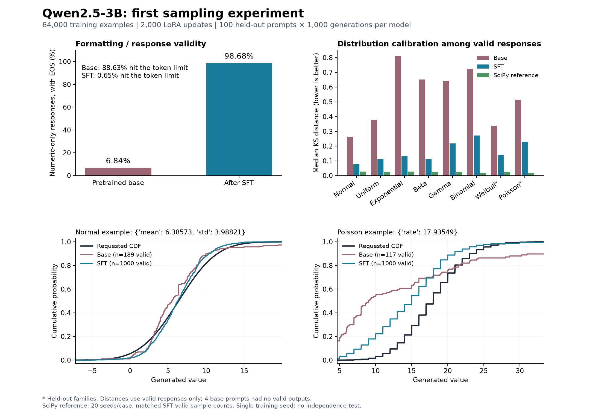

# Learning to sample numbers with Qwen2.5-3B

A completed **supervised fine-tuning (SFT)** experiment: train a language model on independently sampled numeric answers, then test whether its generated numbers follow the requested distributions.

This snapshot contains the SFT baseline, its evaluation code, and the recorded results. The reported experiment used completion cross-entropy. It did not use a KL-based reward or reinforcement learning.



## Results

We evaluated the pretrained base model and the SFT adapter on the same **100 held-out prompts**, with **1,000 independent generations per prompt per model**: 200,000 model responses in total.

| Metric | Pretrained base | After SFT |
|---|---:|---:|
| Numeric-only responses, terminated with EOS | 6.84% | **98.68%** |
| Median normalized Wasserstein distance ↓ | 1.6858 | **0.1122** |
| Median KS distance ↓ | 0.5428 | **0.1392** |
| Out-of-support values among numeric responses | 19.87% | **1.35%** |

Lower distribution distances are better. Wasserstein distance uses a midpoint-quantile approximation and is normalized by the target's 95th–5th percentile width. KS measures the largest difference between the empirical and target cumulative distributions. The reported medians aggregate prompts.

- **Normal distributions:** median KS improved from 0.2613 to 0.0763.
- **Held-out Weibull and Poisson families combined:** median KS improved from 0.4016 to 0.1696.
- **Direct SciPy reference:** median KS was 0.0247 and median normalized Wasserstein was 0.0113, using 20 repetitions per case with sample counts matched to valid SFT responses.

These are encouraging baseline results, with substantial calibration error remaining. Binomial and Poisson have the largest family-median KS errors after SFT.

### Interpretation and limitations

The base model frequently continued writing instead of ending after one number: 88.6% of its generations hit the 32-token limit. Better formatting therefore contributes substantially to the observed gain. A format-matched control is needed to isolate the calibration effect.

Distribution distances are computed **only over valid numeric responses**, including out-of-support values. Four base-model prompts had no valid responses and are excluded from its distance medians. Numeric validity requires one finite number and EOS; it does not require that number to fall inside the target's support.

The model still performs worse than the direct numerical sampler. One training seed was used. This experiment does not establish exact sampling, independence, general language retention, or an effect specifically attributable to RLHF.

## Training setup

| Setting | Recorded value |
|---|---|
| Base checkpoint | [`Qwen/Qwen2.5-3B`](https://huggingface.co/Qwen/Qwen2.5-3B) |
| Model revision | `3aab1f1954e9cc14eb9509a215f9e5ca08227a9b` |
| Training examples | 64,000: 2,000 parameter configurations × 32 independent draws |
| Training families | Normal, uniform, exponential, beta, gamma, binomial |
| Held-out families | Weibull and Poisson |
| Objective | Completion-only cross-entropy, including EOS |
| Adapter | LoRA rank 16, alpha 32, dropout 0.05 |
| Target modules | `q_proj`, `k_proj`, `v_proj`, `o_proj` |
| Optimizer | AdamW, learning rate `2e-4`, weight decay `0.01` |
| Schedule | Cosine decay, 3% warmup |
| Training budget | 2,000 optimizer updates; effective batch size 32 |
| Precision / hardware | BF16 on one NVIDIA H200 |
| Context limit | 128 tokens; overlong examples are rejected |
| Training seed | 42 |

The same prompt appears with different independently sampled correct answers. Continuous answers use five decimal places, integer laws use integer answers, and negative zero is canonicalized. The base weights remain frozen while the LoRA adapter is trained.

Validation uses 160 disjoint parameter configurations. Test prompts cover unseen parameter ranges, the two held-out distribution families, and held-out prompt wording. Family/parameter combinations do not overlap across splits.

Evaluation uses temperature 1, top-p 1, top-k disabled, no repetition penalty, and a 32-token completion budget. Each request generates one answer without sharing generated context with other requests. The evaluation seed is 12345. Invalid answers are not repaired or resampled.

Training occupied an H200 for **4m50s**, including a **4m14s training loop**. Base evaluation took **7m14s**, SFT evaluation **5m43s**, and the benchmark **50s**. Total allocated single-GPU time was **18m37s**, excluding queue time.

## Recorded artifacts

- [`results/sft-v1/report.json`](../results/sft-v1/report.json): consolidated metrics and numerical-reference summary.
- [`results/sft-v1/base/`](../results/sft-v1/base/), [`results/sft-v1/sft/`](../results/sft-v1/sft/): per-prompt JSON/CSV results, summaries, evaluation settings, and run links.
- [`results/sft-v1/training/`](../results/sft-v1/training/): training metrics, configuration, timing, and provenance.
- [`results/sft-v1/test-cases.jsonl`](../results/sft-v1/test-cases.jsonl): the 100 evaluated prompts and target parameters.
- [`results/sft-v1/scipy-reference.json`](../results/sft-v1/scipy-reference.json): the 20 reference repetitions per case.
- [`results/sft-v1/provenance.json`](../results/sft-v1/provenance.json): source snapshot and experiment identifiers.
- [`results/sft-v1/sampling-results.pdf`](../results/sft-v1/sampling-results.pdf): downloadable figure.

Only the two plotted cases' raw generation logs are included in Git. Full raw generations and the trained adapter are stored with the W&B runs. Model weights, credentials, environments, and scheduler logs are not checked in.

| W&B record | Link |
|---|---|
| Training | [SFT run](https://forge.coreweave.com/wandb/yash2007-university-of-washington/stochastic-llm/runs/xcj01bg1) |
| Base evaluation | [Pretrained model](https://forge.coreweave.com/wandb/yash2007-university-of-washington/stochastic-llm/runs/rfddft7y) |
| SFT evaluation | [Fine-tuned model](https://forge.coreweave.com/wandb/yash2007-university-of-washington/stochastic-llm/runs/ao4xvmp5) |
| Results dashboard | [Plots and comparison](https://forge.coreweave.com/wandb/yash2007-university-of-washington/stochastic-llm/runs/zkuvylag) |

## Inspect and reproduce

Python 3.12 is recommended; Python 3.10 or newer is required.

```bash
python3.12 -m venv .venv
source .venv/bin/activate
python -m pip install -e '.[dev,analysis]'
python -m pytest -q
```

The tests use a tiny, locally created Qwen2 model and offline W&B tracking. They do not download or train the full 3B checkpoint.

Regenerate the report and figure from the committed results on CPU:

```bash
python scripts/analyze_results.py
```

Outputs are written to `outputs/results-analysis/`. The reference sampler uses seed 7391; the two displayed CDF examples are the first test case in each selected family.

### Rerun the SFT experiment

The recorded training/evaluation configs require CUDA and online W&B logging. Set `wandb.entity` and `wandb.project` to an account you can use, then authenticate with `wandb login` before running them.

```bash
python -m stochastic_llm generate --config configs/data.yaml
python -m stochastic_llm prepare-model --revision 3aab1f1954e9cc14eb9509a215f9e5ca08227a9b
python -m stochastic_llm train --config configs/sft-h200.yaml
python -m stochastic_llm evaluate --config configs/evaluate.yaml
python -m stochastic_llm evaluate --config configs/evaluate-sft.yaml
python -m stochastic_llm compare outputs/eval-base outputs/eval-sft
```

Fresh output directories are required. Dataset checksums are verified before training. Checkpoints retain optimizer, scheduler, and RNG state; use `train --resume-from-checkpoint PATH` with the original config to resume. Evaluation can resume completed prompt files using `evaluate --resume`. Fixed seeds do not guarantee identical results across hardware or software changes.

For UW Tillicum, the `slurm/` scripts request one full H200. Prepare the Linux environment with `scripts/install_tillicum.sh`, set `HF_HOME` consistently for model preparation and jobs, create `logs/`, and submit with your own Slurm account. `scripts/submit_tillicum.sh ACCOUNT` chains SFT and both evaluations. Submit the separate benchmark script first if a timing estimate is needed.

The pretrained model is governed by its [Qwen model license](https://huggingface.co/Qwen/Qwen2.5-3B). This repository does not redistribute its weights.
