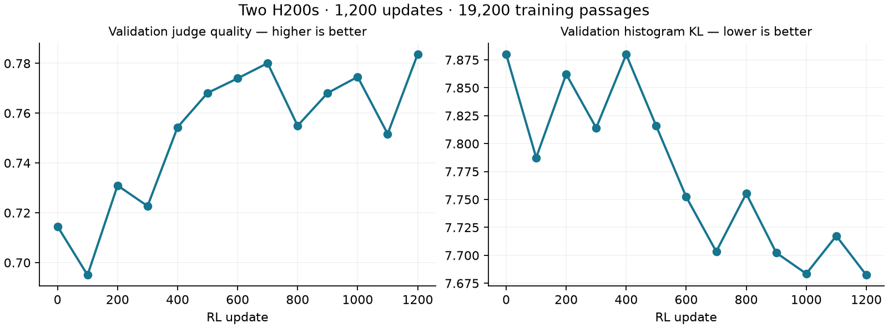

# Completed two-H200 passage RL results

The run completed 1,200 updates and 19,200 training passages in 1h41m21s
on two H200s (approximately 3.38 GPU-hours). It stopped at its update limit.
Both policies were evaluated on the same 16 held-out scenarios, four draws
per scenario, for 64 passages per policy. Decoding and per-rank seeds match.

| Metric | Before RL | After RL |
|---|---:|---:|
| Pooled bigram KL | 8.0710 | 7.9282 |
| Judge coherence /5 | 3.8499 | 3.9985 |
| Judge fluency /5 | 3.9618 | 4.0354 |
| Judge prompt fulfillment /5 | 4.0913 | 4.6011 |
| Combined quality reward /1 | 0.7419 | 0.8029 |
| Mean words per passage | 96.8750 | 115.5156 |
| Out-of-reference bigram rate | 0.6351 | 0.5615 |

Raw pooled histogram KL fell 1.77%. Mean judge quality improved
on 15/16 prompts.
Both models terminated all 64 test responses; this quality gain is not the
short experiment's truncation artifact. Source-overlapping 12-word windows
were absent from both sets; this limited check does not rule out memorization.

## Count sensitivity and uncertainty

The trained model produces about 19.2% more words. Subsampling the pooled
bigrams to 6,136 observations without replacement (200 repeats)
gives mean KL 8.0710 → 7.8762.
This is a post hoc count-sensitivity diagnostic, not a bias correction.

A paired bootstrap over the 16 prompt-mean quality rewards gives an
exploratory 95% mean-improvement interval of [0.04173380102341374, 0.08357494499844806].
It reflects prompt variation within this one seed and judge, not training-seed
variability or human writing quality.

## Interpretation

This is a modest positive result under the frozen judge and a small reduction
in empirical word-bigram mismatch. One seed, one shared reward/evaluation judge,
16 templated held-out scenarios, longer outputs, and sparse estimated KL limit
the conclusion. Some passages remain awkward. It does not establish exact
Shakespeare sampling, independent human-rated improvement, or superiority
to continued SFT or MaD-RL. The broader prompt set also prevents attributing
differences from the short pilot solely to additional training time.

## Validation trajectories

Validation uses 32 passages; its absolute KL is not directly comparable
to the 64-passage final test.

## First saved matched example

Prompt: Write an original dramatic monologue of 80 to 120 words in an intelligible Shakespearean register. Develop the situation coherently and make the decision clear. Do not quote an existing play. Output only the passage.
Situation: Speak as a mapmaker in a lantern-lit harbour. An unexpected act of kindness undermines a prejudice you have long held. Decide how to respond.

### Baseline

Ah, all that flickers behind me on the harbour's edge, where the tide itself seems to bear the weight of judgment and truth, watches on. Yet what now moves me from shadows into light? A stranger, his kind hand outstretched, seen in a different guise than the motley and sullen shadow they once thought me. For his Aeneas wades across the sea of doubt, a bridge of silver shone to build an empathy once butchery wore. Thus, in candlelight's soft glow, cast not out the darkness of prejudice in me, let it not divide, for within its core, a heart not yet hardened, rust new to reform.

### Final

Ah, wondrous harbour, where lanterns cast soft shadows upon the still waters. My parchment and ink rest securely on the sea's embrace, marked with countless tales of lands lost and found. Yet today, our journey has been altered by a stranger, a savior of a stranger. In my heart, the shadow of prejudice has long lain heavy, like an unseasonable fog. But now, as my lantern bears witness to this act of kindness, I too must lift my veil. Shall I choose to weave this new truth into the tapestry of my maps, to show all how a word, a handshake, can light the way for many who wander? So it shall be.

[Training and final evaluation on W&B](https://forge.coreweave.com/wandb/yash2007-university-of-washington/stochastic-llm/runs/zop09jj3)
