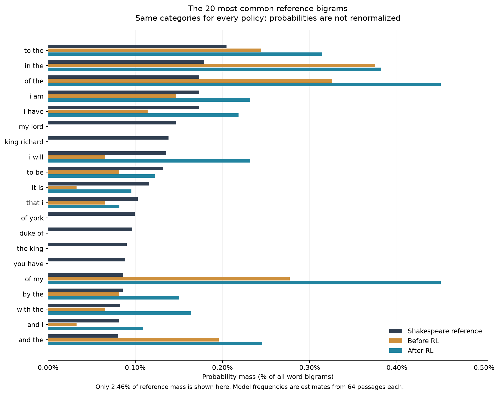
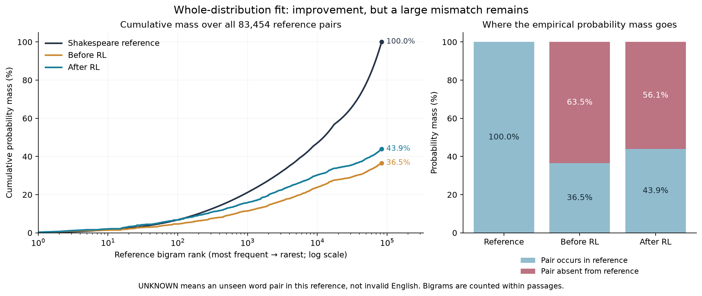

# Single-word distribution matching with a quality reward

Completed Slurm job **499702**, W&B run
[77envg9c](https://forge.coreweave.com/wandb/yash2007-university-of-washington/stochastic-llm/runs/77envg9c).
The run used two H200s for **1h45m57s** (3.5317 GPU-hours), completing
**1,097 updates / 17,552 passages** before the training time budget.
The process exited successfully and saved the final adapter and evaluation.
Adapters, optimizer checkpoints, and full training rollouts remain on GPFS/W&B.
This archive contains every saved test/validation passage, metrics, update
history, target word probabilities, config, source hashes, and diagnostics.

## Objective and implementation

The reference corpus is the same pinned
[Tiny Shakespeare reference](../passage-rl-v1/corpus/reference.txt) used for the
bigram run. Words are lowercase, punctuation is excluded, internal apostrophes
and speaker-name words are retained. The vocabulary contains **10,948 words**
plus UNKNOWN. A generated word absent from the reference counts as UNKNOWN;
this does not mean it is incorrect English. An empty passage contributes one
UNKNOWN observation. A single-word passage contributes that word normally.

For word counts C in the reference and n in a generated group:

```math
p_w=\frac{C(w)}{\sum_v C(v)},\quad p_{\mathrm{UNKNOWN}}=0,
\qquad
\widehat q_w(\mathcal B)=\frac{\sum_i n_i(w)+1/10949}{\sum_{i,v}n_i(v)+1}.
```

Every update first generates **16 complete passages**, eight per GPU. Quality
is judged per passage; the histogram and its KL are computed across the whole
group, not after each word. The same frozen judge scores coherence, fluency,
and prompt fulfillment using conditional expected ratings 1–5, normalized
to 0–1. Truncated passages get zero quality reward and stay in the histogram.

```math
G(\mathcal B)=-D_{\mathrm{KL}}(p\|\widehat q(\mathcal B)),\qquad
J(\theta)=\mathbb E\left[\frac1{16}\sum_i r_Q(Y_i,c_i)+0.1G(\mathcal B)\right]
-0.002\,\mathbb E_cD_{\mathrm{KL}}(\pi_\theta(\cdot|c)\|\pi_0(\cdot|c)).
```

The REINFORCE credit for passage i is its quality leave-one-out advantage
plus `0.1 * 16 * (G(group) - G(group without passage i))`, with the same
separate initial-policy KL term as the bigram run. DDP averages gradients
computed from globally assigned credit. No PPO clipping, GRPO normalization,
learned critic, or human preference training is used. Training logs separate
quality and weighted distribution advantage RMS/standard deviations.

Actor/judge revisions, prompts, seed, LoRA, learning rate, decoding, and
1,200-update configured schedule match the bigram run. This run starts fresh
from the instruction model. Only the distribution target changes; the
quality reward and coefficients stay the same. Actual update counts differ
because this run reached its time cutoff. No lambda sweep was run.

## Results and interpretation

The [repository comparison](../../README.md#unigram-versus-bigram-passage-rl)
reports all three policies on 64 test passages each. Unigram KL decreased
3.0598 → 2.5876; quality increased 0.7419 → 0.7874. The bigram-trained model
has unigram KL 2.7766 and quality 0.8029. Unigram training improved judge
quality on 14/16 prompts relative to the base, but its comparison with
bigram training is split 8/8. Mean length increased 96.88 → 137.17 words,
and one final passage reached the generation cap.

Count matching to 6,200 words gives unigram KL 3.0598 / 2.8589 / 2.7006
for initial / bigram-trained / unigram-trained policies. At 6,136 word pairs,
bigram KL is 8.0710 / 7.8776 / 7.7929. These are means of 200 subsamples,
not corrections removing estimation bias or passage dependence.

One seed, the same judge for reward and evaluation, a small templated test
set, unequal completed update counts, and no human validation limit conclusions.
The results support further investigation of distribution control; they do
not establish improved human-perceived writing or exact corpus sampling.

## Reproduction and plots

From the repository root, with the existing project environment:

```bash
python scripts/analyze_unigram_results.py
python scripts/plot_bigram_fit.py
python -m unittest discover -s experiments/shakespeare-quality-pilot -p 'test_*.py' -v
```

The analysis commands use committed data only and write under `outputs/`.
[final-diagnostics.json](final-diagnostics.json) records count matching and
exploratory prompt-level bootstrap intervals. [manifest.json](manifest.json)
records archive checksums; [source-manifest.json](source-manifest.json) preserves
the training source hashes. The shared corpus and prompt sets are already in Git.

[Training configuration](../../experiments/shakespeare-quality-pilot/unigram-config.json)
and [Slurm launcher](../../experiments/shakespeare-quality-pilot/train-unigram-ddp.sbatch)
reproduce the two-GPU job; launching it spends GPU time. The cluster experiment
directory is `experiments/shakespeare-unigram-v1`, separate from the bigram run.

The [bigram plots](bigram-plots/) archive the earlier reference-versus-bigram-model
plots; they do **not** depict the unigram-trained model. They include PNG/PDF
figures and a CSV of all 83,454 reference word pairs plus UNKNOWN. The top-20
plot covers only 2.46% of reference mass.



