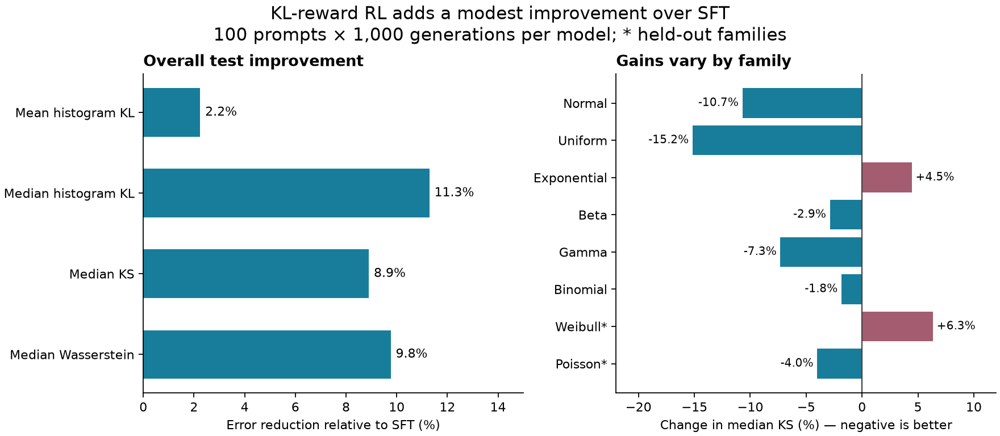

# Completed KL-reward RL experiment

All jobs completed successfully. The final 250-update RL adapter was evaluated,
not the best validation checkpoint at update 225. The starting point was the
completed SFT adapter. RL generated 128,000 training responses and optimized a
negative smoothed forward histogram-KL reward with a leave-one-out group baseline.
No supervised answer labels were used during the RL stage.

The comparison uses the same 100 test prompts, 1,000 generations per prompt,
base model revision, sampling seed, temperature 1, top-p 1, and top-k disabled.
The CLI comparison checks these evaluation identities before accepting the runs.

| Metric | SFT | SFT + KL-reward RL |
|---|---:|---:|
| Mean test histogram KL | 0.227713 | 0.222606 |
| Median test histogram KL | 0.119134 | 0.105688 |
| Median normalized Wasserstein | 0.112249 | 0.101290 |
| Median KS | 0.139199 | 0.126811 |
| Numeric-only responses with EOS | 98.677% | 98.591% |

Mean test histogram KL improved 2.24%.
Its median improved 11.29%.
KS and Wasserstein medians improved 8.90%
and 9.76%, respectively.
KL improved on 61 of 100 prompts;
Wasserstein improved on 65 of 100.

Histogram KL was computed post hoc from all test draws using the same 32-bin,
alpha=0.1 reward definition. Invalid and out-of-support draws remain in the
denominator as an invalid category. Unlike the training/validation batches of
256 draws, test histograms use 1,000 draws; their absolute KL values should not
be compared directly. The test cases also include harder parameter shifts,
unseen families, and unfamiliar wording. KS and Wasserstein are conditional on
valid numeric responses and retain numeric support violations.

Validation mean histogram KL changed from 0.070539 to 0.065246 (7.50% lower).
The held-out Weibull/Poisson aggregate did not improve on median KS or Wasserstein:
KS changed from 0.169606 to 0.175837; Wasserstein from 0.141 to 0.142.
Thus transfer to unseen families is mixed rather than uniformly beneficial.

The paired bootstrap resamples the 100 test prompts 10,000 times (seed 90210).
The mean KL difference has 95% interval [-0.008400899744127928, -0.0018036547157872112].
This exploratory interval reflects prompt variability in this one experiment,
not variability across training seeds. The median KL and median Wasserstein
intervals include zero. There was one training seed, and no control receiving
the same additional compute as supervised fine-tuning. These results support a
small incremental improvement in this run, not general superiority of RL.

Training job time: 22m34s. Evaluation: 5m43s. Benchmark: 2m20s.
The model remains well above the prior direct numerical-sampler reference
(median KS about 0.025 and normalized Wasserstein about 0.011).

- [RL training](https://forge.coreweave.com/wandb/yash2007-university-of-washington/stochastic-llm/runs/tx91cho0)
- [Final held-out evaluation](https://forge.coreweave.com/wandb/yash2007-university-of-washington/stochastic-llm/runs/n9d9aegn)
